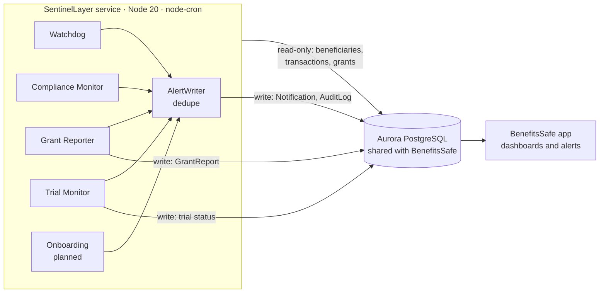

# SentinelLayer

**Autonomous operations agents for [BenefitsSafe](https://github.com/StynerStiner/benefitssafe-app).**
SentinelLayer runs alongside the BenefitsSafe web app as a separate service. It watches benefit thresholds, transactions, grants and trials on a schedule. When something needs a person, it raises an alert.

> The people using BenefitsSafe never talk to these agents. They just see smarter dashboards and earlier warnings.

## Why it exists

A nonprofit's case managers can't re-check every person's benefit limits and every card transaction by hand each day. SentinelLayer does those checks on a schedule. It can't change the money: the agents only **read** financial data, and they write just two things, `Notification` rows and `AuditLog` entries. Every alert can be traced.

## The agents

| Agent | Default schedule | What it does |
|---|---|---|
| **Watchdog** | every 24 h (and on startup) | Scans every active beneficiary. Calculates how close each one is to **SSI** asset limits, **SSDI** SGA, **Medi-Cal** (138% FPL) and **CalFresh** (200% gross / 100% net FPL). Gives a 0–100 risk score and warns case managers at 80% of a limit, or flags critical at 90%. |
| **Compliance Monitor** | every 6 h | Reviews recent transactions for merchant-category (MCC) violations, rapid spending (3+ transactions in an hour), duplicate charges, single purchases over 50% of a grant, and grant overspend. |
| **Grant Reporter** | every 7 days | Builds a structured report for each active grant: disbursement summary, spend by category, beneficiary impact with privacy-safe names, compliance summary and burn-rate projection. |
| **Trial Monitor** | every 12 h | Expires lapsed trial subscriptions, and warns admins once, about 3 days before a trial ends. |
| **Onboarding Coordinator** | every 12 h | *Planned (Phase 4):* will flag stale invites, incomplete profiles and vendor approvals past their SLA. It's a stub today. |

Benefit limits live in `src/services/threshold-calculator.ts`, using 2025 figures with source links (SSA, HHS, DHCS, CDSS). Alerts go through `AlertWriter`, which skips an alert when an unread one already exists for the same event, so staff don't get spammed.

## Architecture



## Tech stack

TypeScript · Node.js 20 · Prisma v7 (PrismaPg adapter) · PostgreSQL (AWS Aurora) · node-cron · Docker (multi-stage build, runs as a non-root user, heartbeat health check) · built to run on AWS ECS/Fargate.

## Run it

```bash
npm install
cp .env.example .env       # point DATABASE_URL at a BenefitsSafe database
npx prisma generate
npm run dev                # every agent, on its schedule
```

Run one agent once, then exit:

```bash
npm run agent:watchdog
npm run agent:compliance
npm run agent:reporter
npm run agent:trial-monitor
```

With Docker:

```bash
docker build -t sentinellayer .
docker run --env-file .env sentinellayer
```

Schedules and alert thresholds are set with environment variables (see `.env.example`). This repo holds no real credentials.

## Layout

```
src/
  agents/      watchdog, compliance, reporter, trial-monitor, onboarding
  services/    threshold-calculator, risk-scorer, alert-writer, report-builder
  utils/       scheduler, logger
  config.ts    env-driven intervals and thresholds
  index.ts     scheduled mode, or single-agent --once mode
prisma/        schema shared with BenefitsSafe
```

---

Part of my [portfolio](https://github.com/StynerStiner/StynerDev-Portfolio) · Building & Automation · by [Styner Stiner](https://github.com/StynerStiner)
